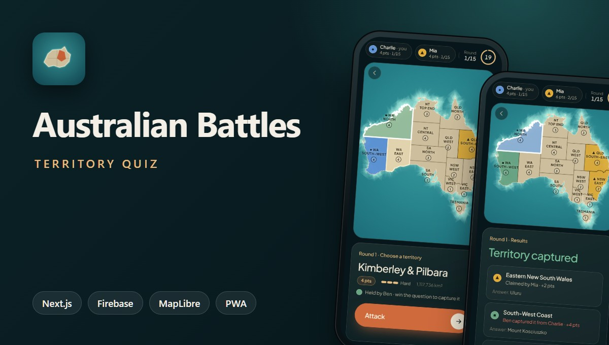
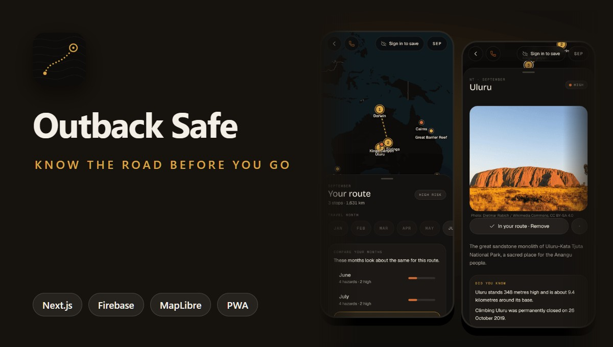
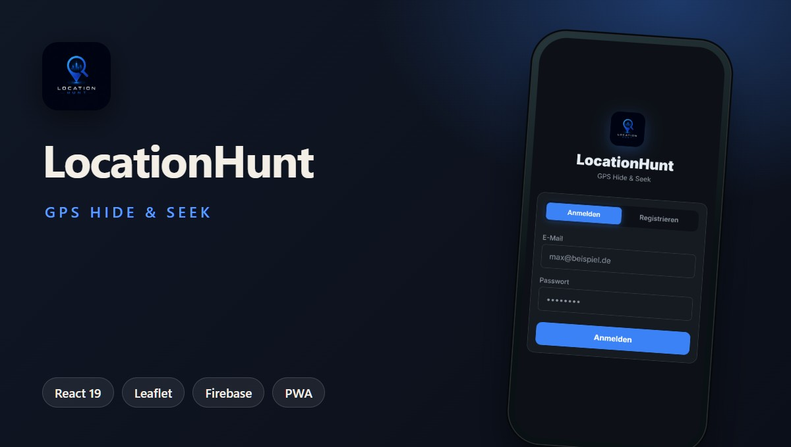
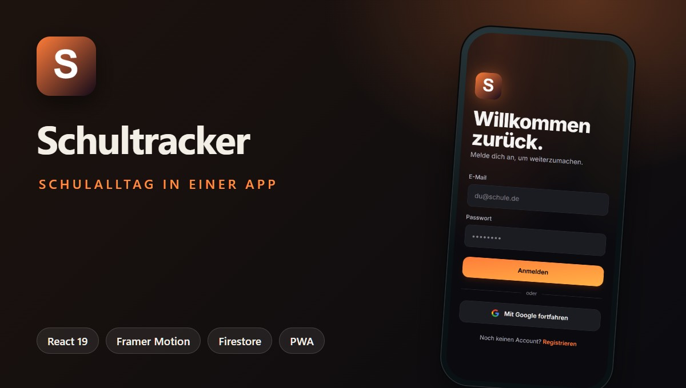

 

 

<b>🇩🇪&nbsp; Deutsch</b> (zum Ein- und Ausklappen)

 

## Projekte

Vier Apps, alle **live im Browser** und als **PWA** auf dem Homescreen installierbar. Ein Klick auf ein Bild öffnet die App.

<table>
  <tr>
    <td width="50%" valign="top" align="center">
       
      Live-Multiplayer-Quiz um Gebiete auf einer Karte von Australien: Per Code oder QR beitreten, ein angrenzendes Gebiet wählen, die Frage beantworten, Land erobern.  
       
      
    </td>
    <td width="50%" valign="top" align="center">
       
      Plane einen Roadtrip durch Australien und sieh, welche Gefahren auf deiner Route lauern, Monat für Monat: mit Karte, Risiko-Score und Notfall-Screen.  
       
      
    </td>
  </tr>
  <tr>
    <td width="50%" valign="top" align="center">
       
      Echtzeit-Versteckspiel für draußen: Hider verstecken sich in einer selbst gezeichneten Zone, Seeker jagen sie per GPS-Ping. Mit Lobby, QR-Beitritt und fünf Spielmodi.  
       
      
    </td>
    <td width="50%" valign="top" align="center">
       
      Der Schulalltag in einer App: Stundenplan, Hausaufgaben, Tests, Notizen mit Apple Pencil und Projekte. Offline-fähig, mit Push-Erinnerungen.  
       
      
    </td>
  </tr>
</table>

## Was alle Projekte gemeinsam haben

- **Mobile-first**: gebaut für das Handy, mit zweiter Spalte auf Tablet und Desktop.
- **Installierbar**: PWA mit Offline-Cache, ohne App Store.
- **Live**: Firebase hält Spieler und Geräte in Echtzeit synchron.
- **Sauber animiert**: weiche Übergänge statt Ruckeln, `prefers-reduced-motion` wird respektiert.
- **Auf Vercel gehostet** und bei jedem Push neu ausgeliefert.

<b>🇬🇧&nbsp; English</b> (click to fold / unfold)

 

## Projects

Four apps, all **live in the browser** and installable on the home screen as a **PWA**. Click an image to open the app.

<table>
  <tr>
    <td width="50%" valign="top" align="center">
       
      Live multiplayer quiz for territory on a map of Australia: join by code or QR, pick a neighbouring territory, answer the question, take the land.  
       
      
    </td>
    <td width="50%" valign="top" align="center">
       
      Plan an Australian road trip and see which hazards wait on your route, month by month: with a map, risk score and emergency screen.  
       
      
    </td>
  </tr>
  <tr>
    <td width="50%" valign="top" align="center">
       
      Real-time hide and seek for the outdoors: hiders hide in a zone you draw yourself, seekers chase them by GPS ping. With lobby, QR join and five game modes.  
       
      
    </td>
    <td width="50%" valign="top" align="center">
       
      School life in one app: timetable, homework, tests, handwritten notes with Apple Pencil and projects. Works offline, with push reminders.  
       
      
    </td>
  </tr>
</table>

## What they all have in common

- **Mobile-first**: built for the phone, with a second column on tablet and desktop.
- **Installable**: PWA with an offline cache, no app store needed.
- **Live**: Firebase keeps players and devices in sync in real time.
- **Properly animated**: smooth transitions instead of jank, `prefers-reduced-motion` is respected.
- **Hosted on Vercel** and redeployed on every push.

